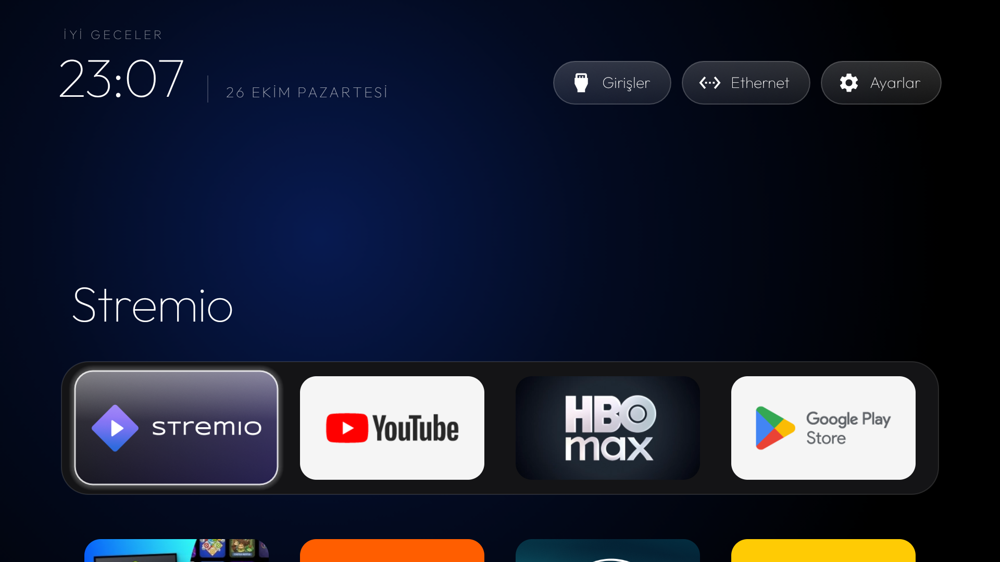
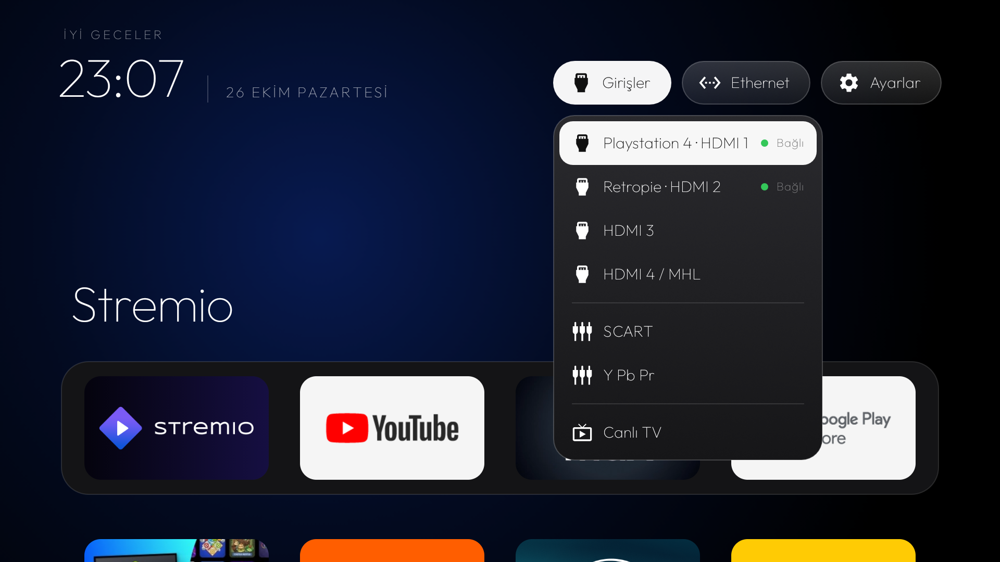

# 📺 Living-room TV: debloat and a clean home screen

A 2016 Philips Android TV, cleaned up without root: vendor and Google telemetry, recommendation and ad services
switched off, and the stock Google TV home screen replaced by a small, offline launcher built from source.

Like the rest of this repository, this page answers **what** was done, **why** it was done that way, what was
**deliberately left alone**, and **what it cost and delivered**.

> 🙏 **Built on [cleanyourtv](https://github.com/Gathin23/cleanyourtv)** by Gathin23 (MIT licence). The
> procedure, the safety checks in `tools/disable.sh` / `tools/restore.sh`, and the launcher
> (`com.gathin.tvhome`) are theirs. The launcher was built from their source with only its `config.xml`
> changed. This folder records how that procedure was applied to one specific TV, the decisions made along the way
> and their outcome. Their reference list for the closest model (`examples/philips-55pus7503`, same Android 8.0,
> different chip) was the starting point, but every package was checked against this TV's own package list
> before anything was disabled.

> 🔒 No IP addresses, account details, serial numbers, network names or device identifiers appear here. Model,
> platform and firmware build are listed because the package lists only make sense against them.

---

## 📊 Overview

| | |
|---|---|
| Device | Philips 55PUS6581/12 (2016), TP Vision platform QM163E (`QM16XE_U`), MediaTek |
| OS | Android TV 8.0.0 (API 26), firmware QM163E.0.26.70.1, security patch 2019-09 |
| Hardware | ~1.3 GB RAM, 1920×1080 UI; on wired Ethernet |
| Method | `pm disable-user --user 0`, one package per call, in 9 small batches with a test after each |
| Result | 23 packages disabled, 0 uninstalled; all 23 still disabled after a full reboot |
| Home screen | cleanyourtv's launcher, 4-slot dock, tile menu and app library on, no `INTERNET` permission |
| Status | ✅ Debloat and launcher done. ADB intentionally still open for theme work; closing it and several days of everyday use are open (see [Open items](#-open-items)) |

| Home | Inputs menu |
|---|---|
|  |  |

---

## 💡 Why

- **The home screen worked for someone else.** The stock Google TV launcher filled the screen with promoted rows,
  a "Shopping" tab and recommendation channels. On a 2016 SoC with 1.3 GB of RAM it was also the heaviest thing
  running most of the time.
- **Telemetry nobody asked for.** The firmware ships two separate analytics paths (Philips' "DAC" collection and
  gathering services, plus a usage logger that records screen-on events and app usage), alongside Google's
  feedback and remote bug-report agents. They start at boot and phone home.
- **The firmware is end-of-life.** The last security patch is from 2019 and no newer firmware will come. Fewer
  network-facing background services means a smaller attack surface on a device that will not be patched again.
- **The network layer could not fix it alone.** The router's DNS blocking (see [`network/`](../network)) already
  filters ad and tracking domains for every device, but it cannot remove a recommendation row from the home
  screen or stop a service from waking up. Removing those had to happen on the TV.

---

## 🛠️ How: the principles

1. **Disable, never uninstall.** Every change is `pm disable-user`, which hides a package for the user while
   leaving it on the system partition. Nothing was flashed or rooted. Every step can be undone.
2. **Back up first.** Before the first change: the full package list, the list of packages that were already
   disabled (none), `getprop` output and all three settings namespaces. `tools/disable.sh` also writes a
   per-batch record of the previous state, which `tools/restore.sh` reads back.
3. **Evidence over package names.** Philips package names (`org.droidtv.*`) often don't say what a package does.
   Each candidate was checked with `dumpsys package` (requested permissions, receivers, services, providers)
   and against the TV's own answers: which packages provide TV inputs, which app opens channels and HDMI, which
   app answers the Settings intent, which apps claim Home.
4. **Small batches, a human test after each.** 3–5 packages at a time (single packages for anything uncertain).
   After each batch: screenshot from the TV, crash/ANR check in the log, then a manual test with the real
   remote: live channels, every HDMI input, Settings, a streaming app, and a standby/resume cycle where the
   batch touched power-state listeners.
5. **The new Home before the old one goes.** The stock launcher was disabled only after the new launcher was
   installed, set as Home, confirmed as the focused window, and tested with the remote.

---

## ✅ What was disabled, and why

| Batch | Packages | Why |
|---|---|---|
| 1 · Google telemetry | `com.google.android.feedback`, `tv.bugreportsender`, `partnersetup`, `onetimeinitializer`, `tvtutorials` | Feedback and remote bug-report agents read system logs and upload them; `partnersetup` reports a partner/client ID at boot; the tutorial and one-time initialiser had already done their job at first setup. |
| 2a · Philips analytics | `org.droidtv.candeebug`, `org.droidtv.gel`, `org.droidtv.sticker` | `candeebug` + `gel` are Philips' DAC analytics pair: they start at boot and on every power-state change and connectivity change, collect, and upload. `sticker` is the retail-shop "e-sticker" banner. |
| 2b · Philips logging/demo | `org.droidtv.usagelogger`, `org.droidtv.demome` | Usage logger (screen-on and app-usage logging, network upload) and the in-store demo mode. Both request the `TV_INPUT_HARDWARE` permission, so the safety check skips them by default; the TV's list of input services showed neither provides a TV input, so they were disabled with a one-command override (`TVINPUT_ALLOW=1`). HDMI and tuner were re-tested afterwards. |
| 3 · Framework logger | `org.droidtv.tv.frameworklogger` | Hands reboot reasons and firmware-install records to the Philips logger. On its own, so a problem after the next reboot would point straight at it. |
| 4 · Philips content | `nettvrecommender`, `nettv.market`, `twittershare`, `dropboxprovider`, `dms` | Top Picks recommendation service, the Philips App Gallery (an installer with silent-install permission), Twitter sharing, a Dropbox document provider and the UPnP media server. Unused, and mostly network-facing. |
| 5 · Google preloads | Play Music, Play Movies & TV, Play Games | Play Music is discontinued; the other two were unused, and each starts at boot. |
| 7 · Stock home | `com.google.android.tvlauncher`, `tvrecommendations` | Replaced by the new launcher. `tvrecommendations` holds the recommendation and ad-signal providers behind the old home screen's rows. |
| 8, 9 · Philips Smart TV home | `org.droidtv.smarttvhome`, `org.droidtv.nettv_launcherapp` | Entry points into the old Philips "Smart TV" home, now redundant. One package per batch, each followed by a test of every remote button. |

There is no batch 6: it held three user-installed apps that ended up uninstalled by hand instead.
Separately, 38 user-installed apps that were no longer used were uninstalled by hand from the TV's own UI.
That was ordinary app management, not part of this debloat, and it is not covered by the restore scripts.

---

## 🚫 What was deliberately left alone, and why

| Kept | Why |
|---|---|
| Tuner, HDMI, SCART, component, CEC (`tunerservice`, `tvserver`, `xtv`, `hdmiService`, `scartService`, `componentService`, `epgdata`, `teletext`, `mheg`, `ci`, `tvcontentprovider`) | This is the TV. Disabling the software layer under an input can leave a port that detects a cable but shows "No Signal" permanently. |
| Live TV app `zapster`, input drawer `philipstvdrawer`, Philips Settings | `zapster` is the app that opens channels and HDMI inputs, Philips Settings answers the Settings intent, and the drawer is the Source menu. Without them the inputs or the way back into Developer options disappear. |
| Remote and power (`GlobalKey`, `tvsystemui`, `DummyWakeUpActivity`, `mediatek.autopair`) | Remote buttons, the on-screen system UI, wake from standby and remote pairing. |
| Ambilight / Hue (`alhuewizard`, `ambihuecommon`) | Wanted. |
| `homeintentresolver`, `leanbackcustomizer`, `icp`, `eum`, `menudataapp`, `nettvregistration`, `nettvbrowser`, `devicesetup`, `networkwizard` | Either part of the Home, menu or input chain, or listed as load-bearing on other Philips boards. Not worth the risk for no clear gain. |
| Factory packages (`org.droidtv.factory*`, `factimageview`, `factthreed`) | Never disabled and never opened, not even to look. On some boards starting a factory app flips a factory-mode flag the shell cannot undo. |
| Android core, Play Store, Play Services, keyboards | Required for the system to boot, install and update apps, and type. |
| Chromecast, Google Assistant, Philips voice assistant | Used. A conscious choice, not a technical limit. |
| Firmware updater (`oad`, `tv.upg`) | Even with little chance of new firmware, cutting off the only official update path gains nothing. |
| DLNA client and Media browser (`dlna`, `contentexplorer`) | Still useful for playing media from the network and USB; only the server (`dms`) was turned off. |
| Gallery installer `nettvapps` | Left alone: it is the silent installer behind the gallery's preloads, and with the gallery itself disabled it has nothing to install. |
| **Not done:** Private DNS | Android 8 has no Private DNS. Even if it had, it would bypass the router's own DNS chain and blocking, which already covers this TV. |
| **Not done:** remapping the Top Picks button | Possible through an accessibility key service in the launcher. On some TVs such a service breaks key repeat (held volume). The button stays dead. |
| **Not done:** boot to Live TV / boot to Home switch | The firmware already lands on Live TV at power-on, which is the preferred behaviour; Home is one button away. |

---

## ⚖️ What it cost, and what it delivered

| Delivered | Cost |
|---|---|
| A home screen with exactly four pinned apps, all apps below, inputs one button away, and no promoted rows, shopping tab or recommendation channels | Google TV's "Continue watching" row and per-app content rows are gone |
| The stock launcher's long-press menu, kept: hold OK (or Menu) on a tile to move it, swap a dock app, take it off Home or open App info; every installed app stays reachable in the App library | Uninstalling is one step further away (App info → Uninstall) |
| Two Philips analytics/logging paths and Google's feedback and bug-report uploaders no longer run | Nothing user-visible |
| Fewer services started at boot and on every power-state change | Not measured: there is no clean "before" baseline, so no speed or memory claim is made here |
| A home screen with no network permission at all: it cannot download ads or report anything | No weather, no content previews on the home screen |
| Smaller attack surface on firmware that will never be patched again | — |
| Everything reversible, per batch or all at once | The restore records must be kept (see below) |
| — | **Top Picks** button on the remote does nothing (its service is disabled, so the button's target activity is gone) |
| — | **Philips TV Collection** / App Gallery no longer opens; gallery web-app shortcuts cannot be reinstalled without re-enabling it |
| — | Play Music / Movies / Games gone (re-enable individually if ever needed) |

Behaviour checked and unchanged: live channels, all four HDMI inputs, SCART and component listed, standby and
resume, every remote button except Top Picks, Chromecast, Assistant, and the streaming apps.

---

## 🔍 Verification

- After each batch: `pm list packages -d` matched exactly what was intended, no `FATAL` or `ANR` in the log, Home
  confirmed as the focused window, screenshot from the TV, and a manual test with the physical remote.
- TV inputs listed by the system before and after batch 2b: tuner, HDMI 1–4, SCART and component. Unchanged.
- Full reboot at the end (after a `sync`, because Android writes package state to disk a few seconds after a
  change): the disabled list before and after the reboot was **identical**. The firmware re-enabled nothing.
- Home resolves to the new launcher only (plus Android's built-in fallback). No setup wizard took over Home.

---

## ↩️ Reversibility

| To | Do |
|---|---|
| Re-enable one package | `tools/tv.py 'pm enable <package>'` |
| Undo everything | [`scripts/restore-all.sh`](scripts/restore-all.sh): every batch, newest first, through `tools/restore.sh`; the Google TV home comes back as Home |
| Rebuild the launcher after changing the dock | [`scripts/install-launcher.sh`](scripts/install-launcher.sh) |

Two caveats:

- `tools/restore.sh` keys its records on the **absolute path of the list file**. The live copies of the lists
  stay at `work/philips-55pus6581/` in the cleanyourtv checkout, and the records in `~/.cleanyourtv/` must be
  kept. The copies in [`lists/`](lists) here are documentation.
- Batches 1–5 were applied while the stock launcher was still Home, so restoring one of them on its own also puts
  the stock launcher back as Home. To bring back a single app, use `pm enable` instead.

The launcher's only changes from upstream are in [`scripts/launcher-config.xml`](scripts/launcher-config.xml).

---

## 🔐 Closing up

Network ADB (port 5555) is plaintext. The last step: revoke the USB debugging authorisations, switch USB
debugging off, reboot, and have `tools/adb-closed.py` see the port **refuse** the connection (a timeout or
"no route to host" proves nothing). Debugging is switched on again only for the length of a change.

**Current state: still open, on purpose.** Network ADB is left on for now so a launcher theme can be tried
before closing up. What the first attempt showed is worth recording:

- Hiding **Developer options** does not stop ADB. After the menu had disappeared from Settings and the TV had
  been unplugged and restarted, port 5555 still accepted connections, and a previously authorised computer was
  still let in as an authorised device. The revoke and the USB-debugging switch had not taken effect.
- The order that matters when closing: open Developer options again, revoke the authorisations, switch USB
  debugging off and see it shown as off, only then turn Developer options off, then a full power cycle.
- Until then the port only admits computers that were authorised before; anything else gets an on-screen prompt.

- [ ] ADB closed and verified (`tools/adb-closed.py` reports the connection refused)

---

## 📝 Open items

- [ ] **Close network ADB** after the theme work (see [Closing up](#-closing-up)).
- [ ] **Several days of everyday use** before calling the list proven. Every batch passed its tests and a full
      reboot, but some problems only show up after days (an overnight standby, a firmware check).
- [ ] **Top Picks button:** left dead on purpose (see above). Revisit only if a key mapping turns out not to
      affect key repeat on this set.
- [ ] **Boot time:** the remote only responds once Android has finished booting (the standby LED stops blinking).
      Nothing safe to change here; the practical answer is standby instead of a mains power-off.
- [ ] **Share upstream:** the list could become an `examples/` entry in cleanyourtv for this platform
      (QM163E has no tested list there yet), following their `docs/workflows/tv-list.md`.
